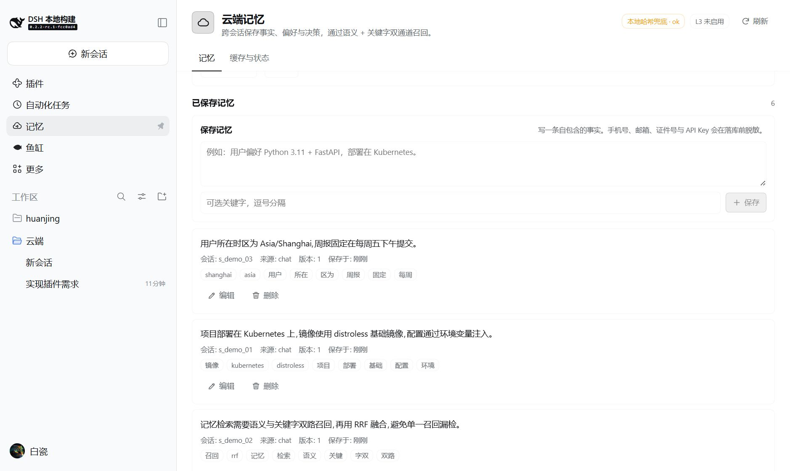
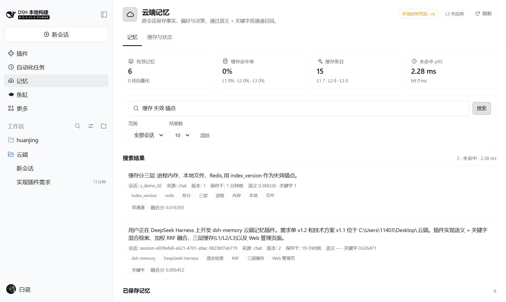
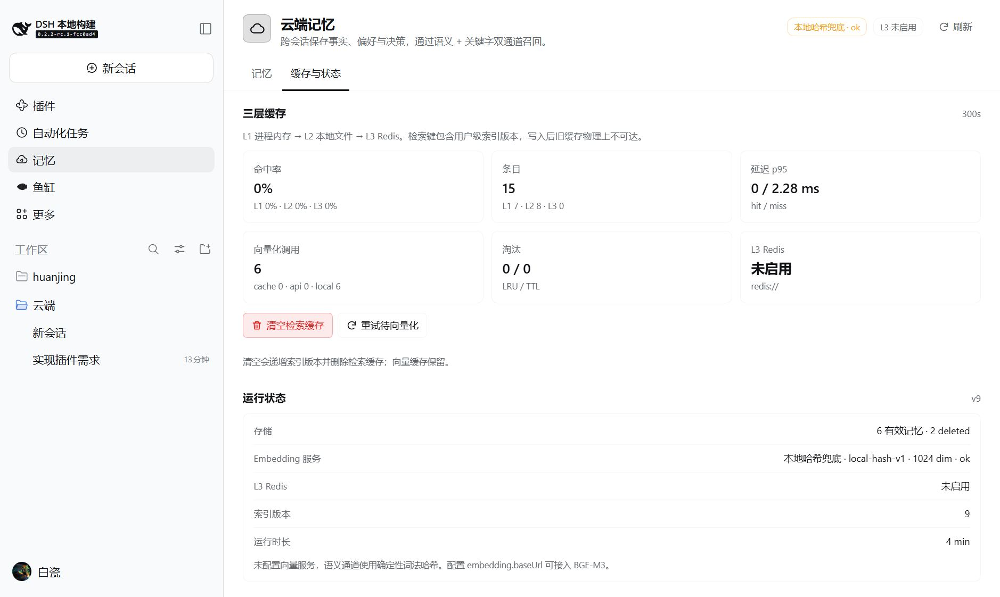

# dsh-cloud-memory — 云端记忆插件

按《dsh记忆插件需求单 v1.2》与《dsh记忆插件技术方案 v1.1》实现的 DeepSeek Harness 插件。它把技术方案中的 FastAPI 记忆服务收敛为 Harness 进程内 Host 插件，同时保留需求单的核心能力：

- 记忆持久化、租户/会话隔离、CRUD 与软删除
- embedding 语义检索 + 关键字 BM25 检索，双路并行、加权 RRF 融合
- 三层缓存（L1 进程内存 → L2 本地文件 → L3 可选 Redis）
- 用户级 `index_version` 缓存失效锚点，写后旧缓存不可读
- PII 脱敏、幂等写入、乐观锁、批量写入、审计记录
- Agent 工具：`memory_search` / `memory_write` / `memory_manage`
- Web 管理页面：搜索、列表、手动保存、编辑、删除、缓存与健康指标

> 面向使用者的操作手册：[docs/USAGE.md](docs/USAGE.md)。  
> 发布到 GitHub/npm 的步骤：仓库根目录的 `PUBLISHING.md`。

## 截图

| 记忆面板 | 混合检索 |
| --- | --- |
|  |  |



## 技术方案映射

| 技术方案 | 本插件实现 | 说明 |
| --- | --- | --- |
| Python 3.11 + FastAPI | Harness Host 插件（ESM，零外部依赖） | 业务与接口契约保持同构；不额外起服务 |
| PostgreSQL 16 | Harness `ctx.storage` 的 JSON KV 后端（`per-record` 布局） | 每条记忆一个文件，位于 `$DSH_HOME/storages/dsh_memory/` |
| pgvector HNSW | 进程内归一化向量 + 余弦暴力检索 | 个人记忆规模（万级）下延迟足够；`VectorIndex` 语义保留 |
| PostgreSQL `tsvector` + jieba | 应用层 `Intl.Segmenter('zh')` 分词 + 内存 BM25 | 对应“应用层分词 + `ts_rank_cd`”的取舍，零扩展依赖 |
| BGE-M3（1024 维） | TEI / OpenAI-compatible `/embeddings` 端点 | 配置端点即接入 BGE-M3；维度固定 1024，换维度需全量重算 |
| 本地兜底 | 确定性词法哈希向量（1024 维） | 未配置端点时可用，但属于词法兜底，不是语义模型 |
| Redis L3 | 内置最小 RESP 客户端（`redis://` / `rediss://`） | 默认关闭；配置 `cache.l3Url` 后启用 |
| RRF（k=60） | 加权 RRF，默认 0.6 / 0.4，和非法时服务端归一化 | 单路召回时该路权重按 1.0 处理 |
| 异步批量写入 | 同步批量接口（≤100 条，一次批量向量化） | 与技术方案遗留项一致，未提供 `202 + task_id` |

## 安装

在 DSH 的 Plugin Manager 中安装本地路径、Git 仓库或解压后的 bundle：

```text
plugin_manager install_bundle
  target: <path-to-dsh-memory>
```

安装后 Host 插件通过 HMR 激活；Web 页面出现在左侧栏底部导航的 **Memory / 记忆** 图标（`main` 面板 `memory`）。若页面未出现，刷新 Web GUI。

## 配置

在 profile 的 `cordis.patch.yml` 中按 row id `dsh-memory` 覆盖配置。所有字段可选。

```yaml
- id: dsh-memory
  config:
    userId: local
    embedding:
      provider: auto          # auto | local | tei | openai
      api: tei                # provider=auto 且 baseUrl 非空时使用
      baseUrl: ""             # 例如 http://127.0.0.1:8090
      model: BAAI/bge-m3
      dim: 1024
      timeoutMs: 120000       # CPU 量化模型冷启动/长文本留足余量
      apiKeyEnv: BGE_M3_API_KEY
      fallbackToLocal: true   # 真实 BGE-M3 时建议 false，避免混入不同向量空间
    retrieval:
      rrfK: 60
      wSemantic: 0.6
      wKeyword: 0.4
      candidateMultiplier: 3
      channelTimeoutMs: 120000
      defaultTopK: 8
    cache:
      ttlSearch: 300
      ttlEmbedding: 604800
      ttlNegative: 30
      ttlJitterRatio: 0.1
      l1MaxEntries: 2000
      l2MaxEntries: 20000
      l2MaxBytes: 67108864
      l2Path: ""              # 默认 $DSH_HOME/storages/dsh-memory/l2-cache.json
      l3Url: ""               # 例如 redis://127.0.0.1:6379/0
      singleflightTimeoutMs: 250
    security:
      piiMask: true
      allowHardDelete: false
    prompt:
      enabled: true
      text: ""                # 留空使用内置系统提示
```

`embedding.provider`：

- `auto`：配置了 `baseUrl` 时走远端，否则本地哈希兜底。
- `local`：强制本地哈希。
- `tei`：TEI `/embed`。
- `openai`：OpenAI-compatible `/v1/embeddings`。

bundle 默认不配置远端端点，使用本地词法哈希兜底。要接真实 BGE-M3，可启动仓库中的 `embedding-service/`（不随 npm 包发布），并按 [`examples/bge-m3.profile-patch.yml`](examples/bge-m3.profile-patch.yml) 在 profile 中配置 `baseUrl`。真实模型下建议 `fallbackToLocal: false`：端点不可用时写入保持 `pending`、语义通道降级为关键字，而不会把词法哈希向量混入 BGE-M3 向量空间。若要使用纯离线词法模式，设置 `provider: local`。

远端失败且 `fallbackToLocal: true` 时，写入仍成功但响应标记 `degraded`；检索结果的 `embed_status` / `degraded_reason` 会体现降级原因。切换 embedding 模型后必须执行一次全量重算：

```text
memory_manage action=reembed force=true
```

## Agent 工具

| 工具 | 用途 |
| --- | --- |
| `memory_search` | 混合检索：语义 + 关键字 + RRF；支持 `topk`、`scope`、`session_id`、`min_score`、`filters` |
| `memory_write` | 保存一条长期记忆；自动脱敏、去重、抽关键字、生成 embedding |
| `memory_manage` | `list` / `get` / `update` / `delete` / `stats` / `purge_cache` / `reembed` |

插件同时注册系统提示段，告诉模型何时检索、何时写入，以及禁止保存密钥。

## HTTP API

Web 页面与外部调用共用同一套接口，前缀 `/dsh-memory/api`：

| 方法 | 路径 | 说明 |
| --- | --- | --- |
| GET | `/health` | 存储、embedding、缓存状态 |
| GET | `/stats?window=300s` | 记忆计数 + 缓存命中率 / 延迟 / 淘汰 / 向量化调用 |
| POST | `/search` | 复杂检索（body 同技术方案 §6.5） |
| GET | `/search?q=&topk=&scope=&session_id=` | 快捷检索 |
| POST | `/memories` | 单条写入；支持 `Idempotency-Key` |
| POST | `/memories:batch` | 批量写入（≤100，`atomic` 可选） |
| GET | `/memories?limit=&cursor=&session_id=` | 游标分页列表 |
| GET | `/memories/{id}` | 读取单条 |
| PUT | `/memories/{id}` | 更新（支持 `version` 乐观锁） |
| DELETE | `/memories/{id}?hard=false` | 软删除；硬删需配置 `security.allowHardDelete` |
| POST | `/cache/purge` | `{level, scope}` |
| POST | `/memories:reembed` | 重试 pending/failed 向量 |
| GET | `/config` | 脱敏后的运行配置 |

响应遵循技术方案的 `{code, message, data, request_id}`；错误码复用 `40001/40003/40301/40401/40901/40902/40903/42201/50301` 等。

## 数据与缓存

- 记忆记录含：`id / user_id / session_id / content / content_hash / keywords / embedding(base64 float32) / embed_status / source / extra / expire_at / version / deleted_at / created_at / updated_at`。
- 写入链路：归一化 → PII 脱敏 → `sha1(user|session|content)` 去重 → 关键字抽取 → embedding（先查向量缓存）→ 落库 → `index_version + 1` → 返回。
- 检索链路：归一化 → 取版本号 → 三层缓存 → singleflight → 语义/关键字并行（超时）→ 加权 RRF → `min_score` → 截断 → 回填缓存。
- 缓存键：`m:s:sha256(user|scope|norm_query|topk|filters_hash|index_version)`；向量键 `m:e:sha256(model|norm_text)`；版本键 `m:v:user`。
- L2 使用原子写（临时文件 + rename），TTL 抖动 ±10%，LRU + 最大条目/字节双限制。
- L3 默认关闭；启用后版本号写入 Redis，使多实例共享失效锚点。

## 目录

```text
dsh-memory/
  index.js              Host 插件入口：配置、服务装配、工具/提示/路由注册
  client.js             Web 面板：sidebar.panellist + main(memory)
  lib/util.js           归一化、PII、分词、关键字、局部 embedding、编码
  lib/keyword.js        BM25 倒排索引、布尔/短语查询
  lib/cache.js          L1/L2/L3、统计、Redis RESP 客户端
  lib/embedding.js      TEI/OpenAI embedding + 缓存 + 本地兜底
  lib/store.js          KV 持久化、内存索引、版本/幂等/审计
  lib/service.js        写入/检索/CRUD/统计业务编排
  lib/http.js           REST 路由
  lib/tools.js          Agent 工具定义
  locale/               插件管理器显示文案
  icon.svg              插件图标
```

## 验证

- 安装后 `cordis_inspect_query` 的 `Tool` 应出现 3 个 `memory_*` 工具；`Slots` 的 `main` 出现 `memory`，`sidebar.panellist` 出现 `memory`。
- HTTP 冒烟：写入含手机号/邮箱的内容 → 读取确认已脱敏；重复写入返回 `deduplicated: true`；搜索两次观察 `cache.hit` 从 `false` 变 `true`；更新后 `index_version` 递增；软删后检索不到。
- 缓存指标：`GET /dsh-memory/api/stats` 中 `cache.hit_rate`、`entries`、`latency_ms` 随请求变化。
- 视觉验证：面板只用 `--dsw-alias-*` 主题变量，无宿主 Client 包依赖；实际渲染需在 Web GUI 中查看。

### 真实 BGE-M3 语义检索基准

运行 `npm run test:semantic`（16 条记忆、8 条查询、8 个关键词干扰项），结果如下：

| 模式 | top1 | top3 | MRR |
| --- | --- | --- | --- |
| semantic-only (`1.0/0.0`) | **100%** | **100%** | **1.000** |
| keyword-only (`0.0/1.0`) | 50% | 100% | 0.729 |
| hybrid `0.6/0.4`（默认） | 88% | 100% | 0.938 |
| hybrid `0.8/0.2` | 88% | 100% | 0.938 |
| hybrid `0.9/0.1` | 88% | 100% | 0.938 |

- 语义单路将 8 条查询全部命中第 1 名，说明 BGE-M3 向量通道有效；关键词单路在“同义改写/零词面重叠”查询上明显不足。
- 混合模式 top3 始终 100%，但 top1 为 88%：唯一失手是“团队什么时候总结本周工作？”，关键词通道把“周一开周会”的记忆推到第 1，而语义通道正确选中“周五迭代复盘”。这是 RRF 的“双通道加分”特性，不是向量质量问题；需要更高 top1 时可把 `wSemantic` 调到 0.8+ 或对 keyword-only 候选加语义阈值。
- 端点实测：单条查询 embedding 约 **19–50ms**（CPU 量化 ONNX），检索整体 miss 约 **46ms**；缓存命中 <1ms。这满足需求单 NFR-1 的缓存命中 <50ms，也为未命中 <300ms 留出余量。
- 端点断开实测：检索返回 `degraded: semantic: fetch failed`，只走 keyword 通道，语义分数为 `null`，不会把本地哈希向量与 BGE-M3 向量混算；降级结果不进入 300s 检索缓存，端点恢复后立即恢复语义检索。

## 本地测试

`test/` 下是无第三方依赖的 Node 测试，覆盖核心链路。一键入口：

```powershell
npm test
```

该命令依次运行：

| 测试 | 覆盖 |
| --- | --- |
| `test/smoke.mjs` | 写入/脱敏/去重/检索/缓存/更新/批量/删除 |
| `test/http.mjs` | Fetch 形态 REST + 幂等键 |
| `test/node-http.mjs` | WebServer 的 Node handler（POST/PUT/DELETE） |
| `test/edge.mjs` | 远端 embedding 降级、原子批量、过滤、乐观锁 |
| `test/cache.mjs` | L2 持久化 + 并发版本号 |
| `test/redis.mjs` | L3 Redis RESP（内置 mock server） |
| `test/chunk.mjs` | 70 条文本按 32 条分片调用 embedding 端点 |

真实 BGE-M3 端点的语义质量测试单独运行（需要先启动仓库中的 `embedding-service/`）：

```powershell
npm run test:semantic
```

## 已知边界

1. **单进程存储**：记忆数据在 Harness 的本地 `storages` 下；多设备/多实例共享需要把同一存储后端换成共享介质，当前 bundle 不包含云端账号同步。
2. **L3 默认关闭**：没有 Redis 时只有 L1/L2；配置 `cache.l3Url` 才具备跨实例版本锚点。
3. **端点不可用**：默认不配远端端点时使用本地哈希；配置真实 BGE-M3 后若端点未运行，语义通道降级为关键字、写入为 `pending`，不会混用不同向量空间。生产环境请把 `embedding.baseUrl` 指向常驻的 TEI/vLLM 服务，并监控 `degraded` 指标与 pending 数量。
4. **自动会话捕获**：未扫描 Session 事件日志（避免对会话日志做二次解释）；自动写入通过系统提示引导模型调用 `memory_write`，以及 Web 面板手动保存。
5. **加密**：脱敏在落库前完成；落盘加密依赖 Harness 存储介质/磁盘加密，未额外实现 AES 列加密。
6. **批量原子性**：`atomic=true` 会预校验并尽力回滚已写入记录，但底层 KV 无跨记录事务，极端 IO 失败仍可能留下部分记录。
7. **配置入口**：本 bundle 不导出 Config schema（零外部依赖），Plugin Manager 不显示表单；所有可调项通过 profile 的 `cordis.patch.yml` 中 `id: dsh-memory` 行配置。
8. **同义词扩展**：需求单 FR-3.2 的“同义词扩展”未实现；中文分词使用 `Intl.Segmenter('zh')`，未知复合词降级为相邻单字二元组。需要同义词词典时可在 `sanitizeKeywords` / `tokenize` 前增加一层映射。
